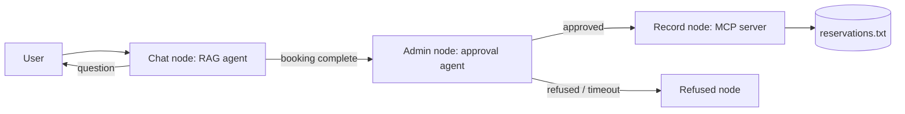

# CityPark Parking Reservation Chatbot

A RAG chatbot that answers questions about a parking lot, collects reservation details, asks a human administrator for approval, and records approved bookings through an MCP server. Orchestrated with LangGraph.

## Architecture



- **Agent 1 (RAG chatbot):** `src/rag/chatbot.py`. Static info (location, rules) is stored in a FAISS vector store. Dynamic data (prices, hours, availability) is stored in SQLite. It collects name, surname, car number and reservation period.
- **Agent 2 (admin agent):** `src/admin/agent.py`. Writes an approval request and waits for the human decision through the Admin Inbox REST API (`src/admin/api.py`).
- **MCP server:** `mcp_server/server.py`. Writes `Name | Car Number | Reservation Period | Approval Time` to `reservations.txt`.
- **Orchestration:** `src/graph.py` (LangGraph).
- **Guardrails:** `src/guardrails/filters.py`. Presidio redacts emails, phone numbers and card numbers. A pattern filter blocks prompt injection.

## Setup

Requires Python 3.12 and access to an Azure-OpenAI-compatible endpoint (EPAM DIAL).

```bash
python3.12 -m venv .venv
source .venv/bin/activate
pip install -r requirements.txt
cp .env.example .env      # then put your real DIAL key in .env
python build_data.py      # builds the SQLite DB and the FAISS index
```

## Run

Terminal 1 (admin inbox):
```bash
uvicorn src.admin.api:app --port 8001
```

Terminal 2 (chat):
```bash
python main.py
```

When the bot says it is waiting for a decision, open http://localhost:8001/docs, get the id from `GET /requests/pending`, and approve or refuse with `POST /requests/{rid}/decision` and body `{"approved": true}`.

Approved bookings appear in `reservations.txt`.

## Tests, evaluation and load test

```bash
python -m pytest -v
python -m eval.evaluate
python -m eval.load_test      # needs the admin inbox running
```

Results: `docs/evaluation_report.md` and `docs/load_test_report.md`.

## Security

- Secrets are stored in `.env`, which is never committed.
- The MCP server runs over stdio as a local child process (no open network port), requires a secret token, validates the car number, and strips `|` and newlines to prevent file-format injection.
- Guardrails redact sensitive data and block prompt-injection attempts.

## Project structure

```
src/            chatbot, admin agent and API, guardrails, graph
mcp_server/     MCP server that writes reservations
eval/           evaluation and load tests
tests/          pytest tests
docs/           reports and diagrams
data/static/    source text for the vector store
```